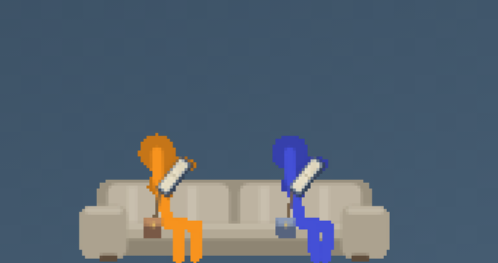

# Reading and everyday-life polish — 2026-10-12

The owner reported figures spending their days reading, awkward neighboring readers, and a standing
figure overlapping a seated one. This pass repairs those behaviors within Pet Quality Update 2.
It does not resume the Chrome/Finder roadmap or replace the procedural figure design.

## What the reference shows

Source: the two owner-provided videos attached to
[v1.0.0](https://github.com/Mallow99/AnimationVsAnimator/releases/tag/v1.0.0).
Reviewed timeline contact sheets for both complete files, then closer half-second frame sequences.
This was sampled visual analysis, not uninterrupted playback; neither supplied file has an audio
stream. Reference videos and extracted frames are local analysis material and are not committed.

| Sequence | Observed acting | Difference from our pets |
| --- | --- | --- |
| AvA 4, 3:20–3:32 | Orange watches the others, inclines his head, and approaches after a readable pause. Group overlap is deliberate and changes with the action. | Our activity labels and speech often communicate intent better than the body does. A resting pose needs attention and a next action. |
| AvA 4, 7:55–8:03 | Orange changes his silhouette as he collides with and breaks the animator's blue obstacle, then recovers and continues. | Our reusable poses and physics support actions, but many transitions have less specific anticipation, impact and recovery. |
| AvM, 1:04–1:10 | Orange stays seated; Green pauses, leans and reaches during their exchange. Orange responds with a hand movement. | Standing/seated roles stay distinct. Our standing spectator could occupy the reader's silhouette, while books and hands spread sideways into the neighboring figure. |
| AvM, 15:22–15:34 | The group converges, slows, places arms around shoulders and holds a shared hug. | Shared attention and a held outcome make an encounter feel connected. Avoiding every overlap would also remove useful physical social contact. |

These movies have directed scenes, camera framing and editing. Matching that feeling in an endless
autonomous pet needs small coherent routines and readable participant roles, rather than permanently
busy bodies or continuous dialogue. This update addresses specific timing/handling regressions;
it does not claim the broader acting quality now matches the films.

## Changes

- Self-chosen reading, watching, gaming and seating use shorter mood/restlessness-sensitive sessions.
  They finish at a page break or game endpoint; changing an activity setting still affects the next
  natural break. Explicitly requested sessions retain their longer pacing. Joining a friend's TV
  activity uses the same autonomous timing.
- Four bounded cooldown timestamps discourage immediately repeating those quiet activities.
  After prolonged stationary time, an energetic figure favors walking, exploring, making something
  or practicing an owned tool at its next choice. Exercise and yo-yo practice have useful weights.
  Work/play relieve boredom, and a quietly seated idle figure can choose a next activity. Sleep stays
  protected. This changes selection at completion rather than interrupting a task every few seconds.
- Autonomous reading requires an owned unfinished book. It no longer silently creates a book merely
  because the supply definition exists. An explicit Read request can still obtain a first stock book.
- Books rise from the lower grip toward the face and tip toward the reader. Both hands follow the
  current open width and page-turn reach, and gaze follows the actual pages. Readers avoid a prone
  couch pose; their seat helper suppresses unrelated couch chatter. The final compact angle keeps a
  raised book clear of the next reader's head, including five seated readers facing the same way.
- Books have finite length (96 pages by default), saved progress and a completed-reading count.
  A page counts after its turn finishes, before closing begins. Closing retains the raised grip
  until the cover shuts; the same original returns to the bag or a real bookshelf slot.
  Interruptions retain completed pages, release light/seat claims and preserve the original.
- Owned-book cards show page/total and percentage or Finished. Inspecting one offers **Read this
  book** or **Read again**, selecting that exact original. Named Settings status shows current book
  and page; All figures does not incorrectly show one person's progress. Progress survives restart,
  custom book artwork/shelves and actual gifts. Optional custom `pages` metadata is documented.
  Old bookmarks beyond 96 keep their progress and get remaining pages; malformed values are bounded.
- An idle standing spectator uses the walking gait to clear the occupied seated row. Vertical body
  overlap is checked through peer snapshots, including the readers' arms. Occupied intervals merge
  so a figure does not oscillate between neighbors. Seated readers keep their claims, and purposeful
  approaches, shared social contact and combat retain their choreography.
- New activity requests cancel a stale walking destination. The seed-1 simulation exposed a figure
  walking away from the requested couch until its approach timed out; its assertion was retained and
  a focused opposite-destination regression added. TV crash/record speech has cooldowns while actual
  game/button movement continues. The live audit also checks finite book state.

## Sanity assessment and evidence

The original seed-32 unattended fixture gave each of five figures books, cups, dumbbells, handhelds
and balls, with a couch, TV, bookshelf, desk, canvas and scooter. Offline, cursor absent, no windows
or daily rhythm; 900 seconds at 30 FPS, sampled once per second. Reading/TV/video games consumed
**79.0%** of all figure-time before the repair and **22.2%** afterward. Each figure performed 12–15
distinct activity types afterward (2–8 before). Another seed, 7, spent **30.1%** on those activities
with 11–17 types. Both runs had 900 live audits, no reported issues and no stranded seated-idle state.
The old fixture also had no stranded seated-idle state: the measurable original problem was activity
dominance, not a proven universal idle deadlock. These two runs demonstrate variety, not a guarantee
that every figure will perform every activity in every session.

Reports: [before](verification/polish-life-before-32.json),
[after, seed 32](verification/polish-life-32.json),
[after, seed 7](verification/polish-life-7.json).
Repeat with `LIFE_SEED=32 npm run lifeprofile`; optionally set `LIFE_SECONDS` (60–7200).
The script distinguishes activity, mode, walking, speech and stranded seating.

Functional feature soak: [polish-soak-32.json](verification/polish-soak-32.json), 2,566.4 seconds,
2,635 audits, 35 phases, no reported issues. Final compact grip is additionally checked in the
focused regressions, complete browser/preset suite and final rendered animation capture.

Current verification and hardware limits are recorded in [HANDOFF.md](HANDOFF.md).
Eleven focused regressions include actual finite completion/reread/gift/custom-shelf behavior,
autonomous versus requested durations, sleeping/quiet seating, raised reachable grips, neighboring
heads, five readers/departure, normal games and replaced walking destinations. Actual Chromium
checks use pointer input for the new book controls and inspect both facings and every preset.
Independent peaceful browser fixtures now clear prior combat shots and explicitly stop/stow the
previous scene before catch; no spectator or ownership assertion was relaxed.

### Preview captures

These are renders from the running cloud/Linux browser preview, using controlled simulation steps.
Animation captures sample at 10 FPS and zoom the existing pixel art; they are not replacement art,
new character designs, or native Mac recordings. Reproduce frames with
`POLISH_RECORD=1 npm run browsercheck`, then convert each `.build/polish-reading-*/%03d.png`
sequence to a GIF at 10 FPS. Static pair/five-reader frames are produced in ordinary `browsercheck`.

[Opening](verification/polish-reading-opening.gif) ·
[Page turns](verification/polish-reading-pages.gif) ·
[Closing](verification/polish-reading-closing.gif) ·
[Getting up and walking clear](verification/polish-reading-departure.gif)

## Still worth improving

- More action-specific anticipation, recovery and nonverbal reactions; quieter group attention and
  shared outcomes. The next quality pass should stage a few complete short routines and inspect
  their motion rather than grow the item or integration catalog first.
- Complicated crowded approaches and extreme/mixed-size seating remain separate from this idle-row
  repair. Bodies still intentionally overlap during passing, cooperation, hugging and fighting.
- Books track progress but do not contain readable text or distinct authored stories. Handhelds
  still offer the existing runner rather than a library of games.
- Native Mac focus/Spaces/desktop return, Swift helpers and real file detection; Windows native
  input/DPI/helpers; main-display and existing physics limits. These require hardware acceptance.
- Resource numbers below are Linux software-rendering measurements, not Mac estimates or leak proof.

Fresh five-figure furnished Electron sample (9 furniture, 20 items, 1440×900 Xvfb): median **348 MiB
PSS**, **422 MiB** with Settings open, **384 MiB** after closing. Aggregate RSS was 675/838/715 MiB,
which counts shared pages repeatedly; PSS apportions them. Ten samples per phase after warm-up,
offline and disposable saves; seven processes, eight with Settings. Raw report:
[polish-ram-5-rich.json](verification/polish-ram-5-rich.json).

Core profile with five figures, ten loose items and couch/bookshelf: mean **2.483 ms**, p95 **6.040 ms**
per combined 120 Hz update (8.33 ms budget), with another browser verification running. Final
Chromium rendered frame intervals were median/p95 **16.7/16.7 ms**. Heavier concurrent cloud runs
had higher tail times; these observations do not establish native Mac rendering performance.

Stop here before any further integration milestone.
